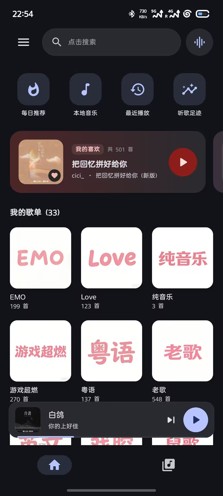
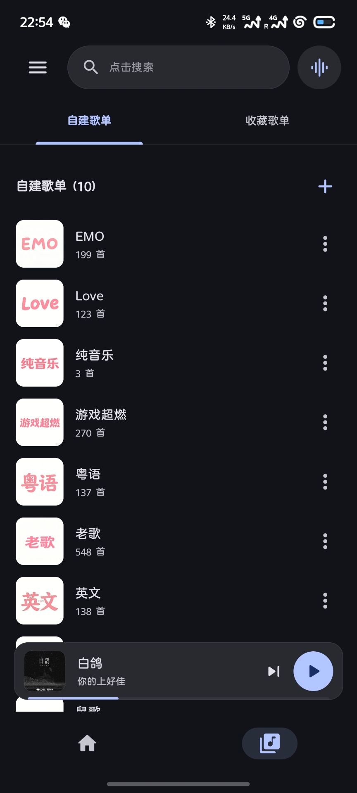

# QQ Music Player

A third-party QQ Music player for phones and Android TV.

## Download

See [Releases](https://github.com/BakInt/melodist/releases/tag/v1.0).

| File | Device |
| :--- | :--- |
| `melodist-mobile-1.0.apk` | Phone |
| `melodist-mobile-originos-1.0.apk` | Phone (with system media control center support; cannot coexist with an app of the same package name) |
| `melodist-tv-1.0.apk` | Android TV |

## Screenshots

| Home | Playlists |
| :---: | :---: |
|  |  |

## Notes

- All builds are debug-signed and intended for personal study and research only.
- The app does not provide or store any media content.
- This project is not affiliated with the official app.

## License

Released under the [MIT License](LICENSE).
