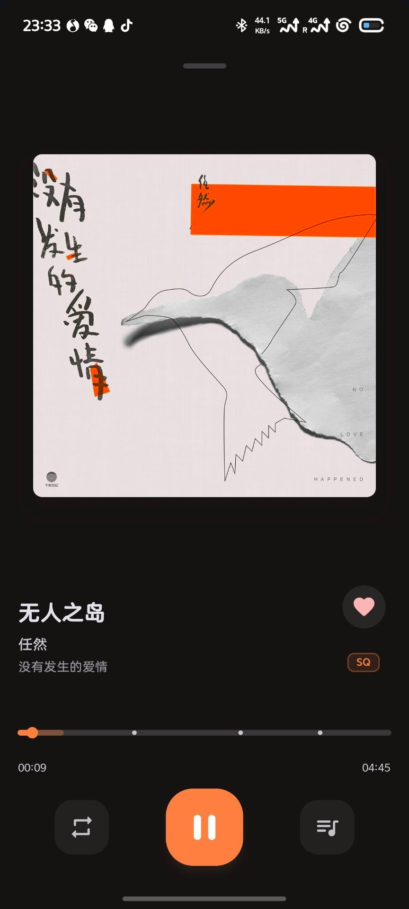

# QQ 音乐播放器

一个第三方 QQ 音乐播放器，支持手机与 Android TV。

## 下载

见 [Releases](https://github.com/BakInt/melodist/releases)。

| 文件 | 设备 |
| :--- | :--- |
| `melodist-mobile-1.7.5-666.apk` | 手机 |
| `melodist-mobile-originos-1.7.5-666.apk` | 手机（系统媒体控制中心适配版，不能与同包名应用共存） |
| `melodist-tv-1.7.5-666.apk` | Android TV |

## 截图

| 主页 | 播放界面 |
| :---: | :---: |
|  |  |

## 说明

- 全部为 debug 签名，仅供个人学习研究。
- 应用不提供、不存储任何媒体资源。
- 本项目与官方无关联。

## 开源协议

基于 [MIT License](LICENSE) 开源。
